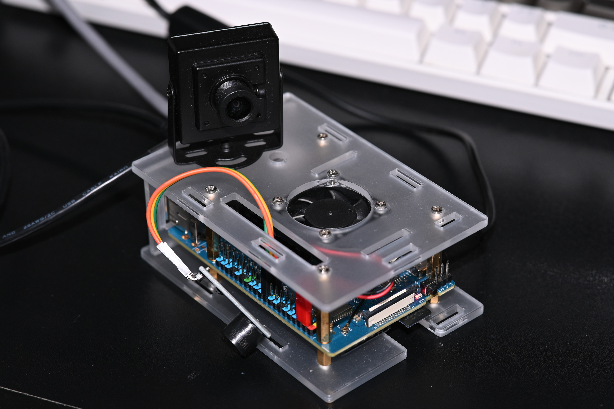
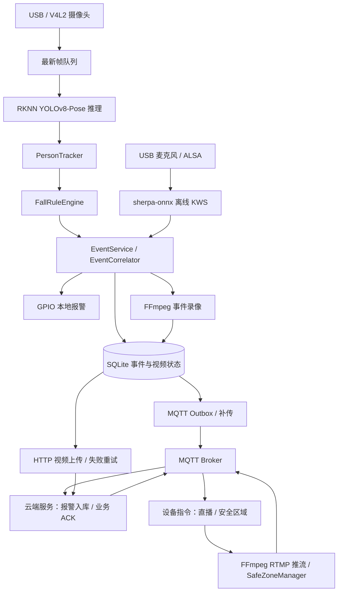

# 基于 YOLOv8-Pose 与离线语音关键词识别的跌倒监测系统

## 项目简介

面向室内看护场景的嵌入式边缘网关，运行于 **Orange Pi 3B（Rockchip RK3566，ARM64）**。系统通过摄像头采集人体姿态、USB 麦克风识别求救关键词，将视觉与语音事件进行关联，并提供本地报警、事件录像、SQLite 持久化、MQTT 报警及 HTTP 视频上传能力。

> **仓库范围**：本仓库是 C++ 边缘网关实现，不包含云端 FastAPI 服务、管理客户端或小程序源码。跨端协作需要分别部署对应组件。



## 主要功能

| 模块 | 实现方式 | 作用 |
| --- | --- | --- |
| 人体姿态识别 | YOLOv8-Pose + RKNN Runtime | 在 RK3566 NPU 上执行姿态推理，输出人体框和 17 个关键点 |
| 跌倒判定 | 人体跟踪 + 规则状态机 | 综合躯干倾角、髋部/人体框下降速度和持续躺卧时间识别异常姿态 |
| 误报抑制 | 支撑腿特征 + 安全躺卧区域 | 区分部分弯腰场景；对预设床/沙发区域内的正常躺卧进行抑制 |
| 语音求救 | ALSA + sherpa-onnx KWS | 使用本地 ONNX 模型进行离线关键词检测，不依赖云端语音识别 |
| 多模态事件关联 | EventCorrelator | 按时间窗口关联视觉与语音事件，保留事件来源及版本信息 |
| 本地告警 | GPIO 蜂鸣器 | 检测到需要报警的事件后触发本地提示 |
| 事件可靠性 | SQLite + MQTT QoS 1 + 业务 ACK | 先本地持久化，网络恢复后重试发送；收到云端业务确认后更新状态 |
| 视频能力 | FFmpeg / `h264_rkmpp` | 事件前后视频片段录制、HTTP 上传及按指令启动/停止 RTMP 推流 |
| 远程管理 | MQTT 设备指令 | 支持直播启停、安全躺卧区域热更新及命令执行结果上报 |
| 运行监管 | RuntimeSupervisor + systemd | 监测摄像头、音频和后台服务状态，支持恢复重试与服务守护 |

> 上述功能描述对应仓库已实现的代码路径；实际使用效果受模型、摄像头视角、麦克风、设备驱动和部署环境影响。系统属于辅助监测方案，不应作为唯一的紧急救援保障手段。

## 系统架构



**实现边界与设计要点：**

- 采用 `Domain / Application / Infrastructure` 分层，领域规则不直接依赖 RKNN、ALSA、MQTT 等外部 SDK。
- 视觉处理在独立工作线程执行；采集队列优先保留新帧，减少积压帧带来的实时性损失。
- 每个跟踪目标维护独立的跌倒状态（`NORMAL`、`SUSPECTED_FALL`、`CONFIRMED_FALL`、`ALARMED`），根据快速下降或持续异常躺卧触发不同转换路径，并支持恢复。
- 事件由内存队列交给消费线程；拥塞时尝试使用 SQLite 溢出缓存，减少仅依赖内存队列造成的事件丢失风险。
- MQTT 的 QoS 1 `PUBACK` **不等于业务处理成功**：事件只有经云端业务 ACK 确认并完成本地状态提交后，才视为已上传。融合更新通过 `revision` 防止旧 ACK 误确认新版本。

## 技术栈与运行环境

| 类别 | 技术 |
| --- | --- |
| 边缘硬件 | Orange Pi 3B、RK3566（4 × Cortex-A55，NPU） |
| 目标系统 | Orange Pi Ubuntu 22.04 / Linux 5.10（AArch64） |
| 语言与构建 | C++17、CMake、Ninja、GCC AArch64 交叉编译器 |
| 图像与推理 | OpenCV、RKNN Runtime、YOLOv8-Pose |
| 语音 | ALSA、sherpa-onnx C API、ONNX KWS 模型 |
| 消息与存储 | Eclipse Paho MQTT C/C++、SQLite3、nlohmann/json |
| 视频与传输 | FFmpeg（Rockchip MPP 编码）、libcurl |
| 运维 | spdlog、systemd、Linux 设备接口 |

开发环境可使用 Ubuntu/WSL2；最终生成的 **AArch64 二进制需要在目标开发板上运行**，不能直接在 x86_64 主机执行。

## 目录结构

```text
fall-monitoring-system/
├── apps/main.cpp                   # 进程入口、SIGINT/SIGTERM 处理
├── include/fall_monitoring/        # 公共接口与类型定义
├── src/
│   ├── app/                        # Application：组装组件与生命周期
│   ├── application/                # 视觉、音频、事件、网络、指令和运行监管
│   ├── domain/                     # 跌倒规则、人物跟踪、事件关联
│   └── infrastructure/             # RKNN、ALSA、MQTT、SQLite、FFmpeg 等实现
├── configs/
│   ├── config.json                 # 网关参数
│   └── scene_config.json           # 归一化安全躺卧区域
├── deploy/
│   └── fall-monitoring-gateway.service
├── aarch64-toolchain.cmake         # ARM64 交叉编译工具链
├── CMakeLists.txt
├── build/                          # CMake/Ninja 构建中间文件（不提交）
├── bin/                            # 最终可执行文件（不提交）
├── sysroot/                        # 从开发板同步的 ARM64 依赖（不提交）
├── third_party/sherpa-onnx/        # ARM64 KWS SDK（不提交）
└── models/                         # 运行时模型文件（按需部署）
```

`build/`、`bin/`、`sysroot/`、第三方动态库以及 `.rknn`、`.onnx` 模型文件均不应作为普通源码提交到仓库。模型、数据文件和运行时依赖须由使用者自行准备。

## 构建：Ubuntu / WSL2 交叉编译

### 1. 安装主机工具

```bash
sudo apt update
sudo apt install -y \
  build-essential cmake ninja-build \
  gcc-aarch64-linux-gnu g++-aarch64-linux-gnu \
  pkg-config rsync git curl

git clone https://github.com/ycpanu/fall-monitoring-system.git
cd fall-monitoring-system
```

### 2. 准备目标板 sysroot

交叉编译需要目标板实际使用的 ARM64 头文件和共享库，包括 OpenCV、RKNN、ALSA、SQLite、Paho MQTT、libcurl 等。建议从**与部署目标相同系统版本**的 Orange Pi 同步：

```bash
# 在编译主机执行；将 BOARD_IP 改为开发板实际地址
BOARD_IP=192.168.137.227
mkdir -p sysroot/usr/include sysroot/usr/lib sysroot/lib

rsync -a orangepi@"$BOARD_IP":/usr/include/ sysroot/usr/include/
rsync -a orangepi@"$BOARD_IP":/usr/lib/     sysroot/usr/lib/
rsync -a orangepi@"$BOARD_IP":/lib/         sysroot/lib/
```

注意：部分 BLAS/LAPACK 库由 `/etc/alternatives` 管理符号链接。如果交叉链接时出现 `sscal_`、`slange_` 等未定义符号，应检查 sysroot 的 `libblas.so*`、`liblapack.so*` 及其真实指向，必要时使用 `rsync -aL` 补齐实际文件；不要通过混用 x86_64 库解决。

### 3. 准备 RKNN 与 sherpa-onnx SDK

RKNN 需要与目标板 Runtime 兼容的 `rknn_api.h` 和 `librknnrt.so`。本项目使用的 sherpa-onnx C API 目录约定如下：

```text
third_party/sherpa-onnx/
├── include/sherpa-onnx/c-api/c-api.h
└── lib/
    ├── libsherpa-onnx-c-api.so
    └── ...（同一发行包中的其他动态库）
```

可使用与目标架构匹配的 **sherpa-onnx v1.12.1 Linux AArch64 shared CPU** 发行包，并配套相同版本的 `c-api.h`。将发行包 `lib/` 中的全部动态库（含依赖及有效符号链接）复制到上述目录。不要使用 x86_64 版本的 SDK。

### 4. 配置并编译

```bash
cmake -S . -B build -G Ninja \
  -DCMAKE_TOOLCHAIN_FILE="$PWD/aarch64-toolchain.cmake" \
  -DCMAKE_BUILD_TYPE=Release \
  -DRKNN_INCLUDE_DIR="$PWD/sysroot/usr/include" \
  -DRKNN_LIBRARY="$PWD/sysroot/usr/lib/librknnrt.so" \
  -DSHERPA_ONNX_INCLUDE_DIR="$PWD/third_party/sherpa-onnx/include" \
  -DSHERPA_ONNX_C_API_LIBRARY="$PWD/third_party/sherpa-onnx/lib/libsherpa-onnx-c-api.so"

cmake --build build --parallel 4
file bin/fall_monitoring_gateway
```

`RKNN_LIBRARY` 的位置取决于实际 sysroot；如果文件不在示例路径，请使用 `find sysroot -name 'librknnrt.so*'` 找到后替换。成功时 `file` 应显示 **ARM aarch64**。项目的中间文件保留在 `build/`，最终可执行文件生成于 `bin/fall_monitoring_gateway`。

## 开发板部署与运行

### 1. 上传程序、配置和动态库

在**编译主机**执行：

```bash
BOARD_IP=192.168.137.227
REMOTE="orangepi@$BOARD_IP"
REMOTE_DIR="/home/orangepi/projects/fall-monitoring-system"

ssh "$REMOTE" "mkdir -p '$REMOTE_DIR'/bin '$REMOTE_DIR'/configs '$REMOTE_DIR'/models/kws '$REMOTE_DIR'/third_party/sherpa-onnx/lib"
rsync -av bin/fall_monitoring_gateway "$REMOTE:$REMOTE_DIR/bin/"
rsync -av configs/ "$REMOTE:$REMOTE_DIR/configs/"
rsync -avL third_party/sherpa-onnx/lib/ "$REMOTE:$REMOTE_DIR/third_party/sherpa-onnx/lib/"

# 模型文件需先自行放入编译主机的 models/；也可以直接在开发板复制已有模型
rsync -av models/ "$REMOTE:$REMOTE_DIR/models/"
```

**必须准备的运行时模型文件**（路径与 `configs/config.json` 默认值一致）：

```text
models/
├── yolov8n-pose-512-hybrid.rknn
└── kws/
    ├── encoder-epoch-12-avg-2-chunk-16-left-64.int8.onnx
    ├── decoder-epoch-12-avg-2-chunk-16-left-64.int8.onnx
    ├── joiner-epoch-12-avg-2-chunk-16-left-64.int8.onnx
    ├── tokens.txt
    └── keywords_custom.txt
```

若不使用语音检测，可在配置中将 `audio.enabled` 和 `kws.enabled` 设为 `false`；RKNN 姿态模型仍是视觉监测必需项。

### 2. 修改部署配置

在开发板上编辑 `configs/config.json`，至少核对以下参数：

| 配置项 | 说明 |
| --- | --- |
| `model.rknn_model_path` | RKNN 模型路径 |
| `vision.camera_device_id` | 摄像头索引 |
| `audio.device` | ALSA 录音设备，例如 `plughw:CARD=Device,DEV=0` |
| `kws.*_path` | KWS 模型、tokens 与关键词文件路径 |
| `network.mqtt_broker` | MQTT Broker 的实际 IP/端口 |
| `network.api_base_url` | FastAPI 服务地址 |
| `hardware.buzzer_enabled` / `hardware.buzzer_gpio_pin` | 是否启用蜂鸣器及 GPIO 编号 |
| `storage.sqlite_db_path` | SQLite 文件路径 |
| `scene.config_path` | 安全躺卧区域 JSON 文件路径 |
| `live_stream.encoder` / `video_recording.encoder` | FFmpeg 编码器，默认 `h264_rkmpp` |

仓库内的 `10.48.212.22` 属于示例网络环境，**不能直接假定适用于你的网络**。摄像头、录音设备与 Rockchip 视频编码支持情况可分别通过 `ls /dev/video*`、`arecord -l`、`ffmpeg -encoders | grep h264_rkmpp` 检查。`scene_config.json` 中的示例区域须根据实际画面重新标定。

### 3. 检查依赖并启动

```bash
ssh orangepi@192.168.137.227
cd ~/projects/fall-monitoring-system

# 检查目标板动态库是否齐全
ldd bin/fall_monitoring_gateway | grep 'not found'

# 正常使用摄像头
./bin/fall_monitoring_gateway

# 或将本地视频文件传给视觉输入端（用于调试）
# ./bin/fall_monitoring_gateway /path/to/test.mp4
```

如果存在 `libsherpa-onnx-c-api.so => not found`，先确认 `third_party/sherpa-onnx/lib/` 已上传。CMake 配置了相对于二进制目录的 RPATH；若所部署的旧二进制不包含该路径，可临时执行：

```bash
LD_LIBRARY_PATH="$PWD/third_party/sherpa-onnx/lib${LD_LIBRARY_PATH:+:$LD_LIBRARY_PATH}" \
  ./bin/fall_monitoring_gateway

# 仅在确实需要管理员权限时使用；sudo 默认可能清理 LD_LIBRARY_PATH
# sudo env LD_LIBRARY_PATH="$PWD/third_party/sherpa-onnx/lib" ./bin/fall_monitoring_gateway
```

推荐优先配置摄像头、ALSA、GPIO 等设备访问权限，而不是长期以 root 身份运行。

日志默认输出至终端及 `logs/gateway.log`：

```bash
tail -f logs/gateway.log
```

### 4. 使用 systemd 守护（可选）

项目包含 `deploy/fall-monitoring-gateway.service`，采用 `Type=notify`、自动重启和 watchdog。**安装前先检查 unit 中的用户、工作目录和权限**：

```bash
sudo cp deploy/fall-monitoring-gateway.service /etc/systemd/system/
sudo systemctl daemon-reload
sudo systemctl enable --now fall-monitoring-gateway.service
sudo systemctl status fall-monitoring-gateway.service
journalctl -u fall-monitoring-gateway.service -f
```

如果动态库加载仍有问题，应先确认可执行文件的 `RPATH/RUNPATH` 或在 service 中设置绝对路径的 `LD_LIBRARY_PATH`。必须以 `WorkingDirectory` 指定的工程根目录运行，因为配置、模型及数据库使用了相对路径。

## MQTT 与云端接口

边缘网关使用以下主题（`<device_id>` 取自 `device.device_id`）：

| 主题 | 方向 | 用途 |
| --- | --- | --- |
| `fall_detection/alerts` | 网关 → Broker | 报警事件，QoS 1；支持事件版本 `revision` |
| `fall_detection/ack/<device_id>` | 云端 → 网关 | 业务保存确认；驱动本地事件状态更新 |
| `fall_detection/status/<device_id>` | 网关 → Broker | 设备状态/心跳 |
| `fall_detection/commands/<device_id>` | 云端 → 网关 | `start_live`、`stop_live`、`update_safe_zones` 指令 |
| `fall_detection/command_results/<device_id>` | 网关 → Broker | 设备指令执行结果 |

视频文件由网关通过 **HTTP `POST /api/upload/video`** 上传，独立于 MQTT 报警消息。云端需要按约定处理 `event_id`、`revision`、业务 ACK 及视频上传响应；仅启动 MQTT Broker 并不等于全链路已连通。

## 性能记录

| 测试项 | 历史实测结果 | 统计口径 |
| --- | ---: | --- |
| 视觉 AI 主循环吞吐 | **约 14.76 FPS** | 76 个统计窗口，累计 5,649 帧；不是摄像头采集 FPS |
| `rknn_run` 平均调用耗时 | **62.14 ms/帧** | 48 批、4,800 帧；为调用墙钟时间，不等于完整端到端时延 |
| 网关进程平均 RSS | **约 227 MiB** | 300 秒、1 秒间隔采样；为驻留内存，并非独占内存 |
| MQTT Broker 回环平均 RTT | **3.97 ms** | 100 次 QoS 1 回环；不包含云端业务处理与报警链路 |
| SQLite 持久化回归 | **50/50 次通过** | 不能据此证明断电零丢失 |


